## operaciones basicas con opencv
## alumno David Barrera NC = 1388
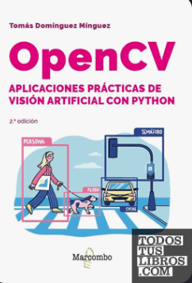
# 1 lectura de la imagen desde la carpeta
## cuando no carga la imagen
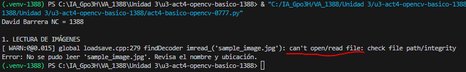
## cuando carga la imagen
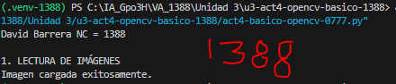
## propiedades de la imagen
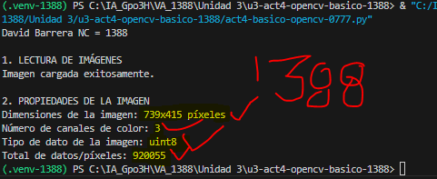
## visualizacion de la imagen original
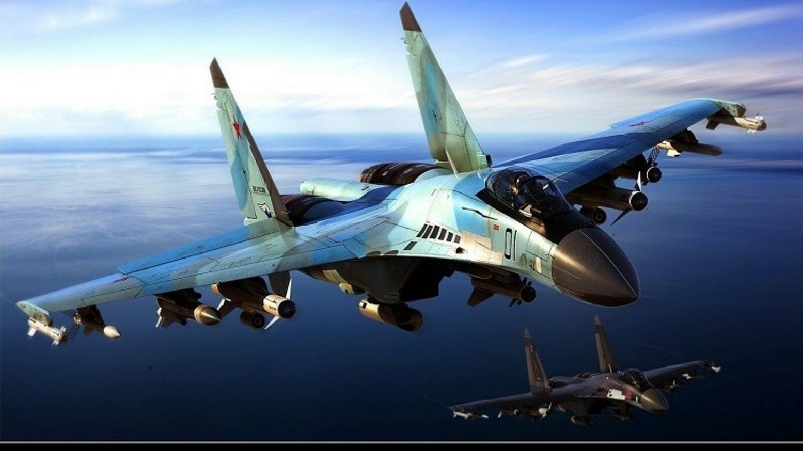
## en la terminal
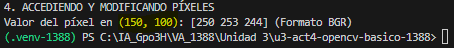
## 4. ACCESO Y MODIFICACIÓN DE PÍXELES INDIVIDUALES
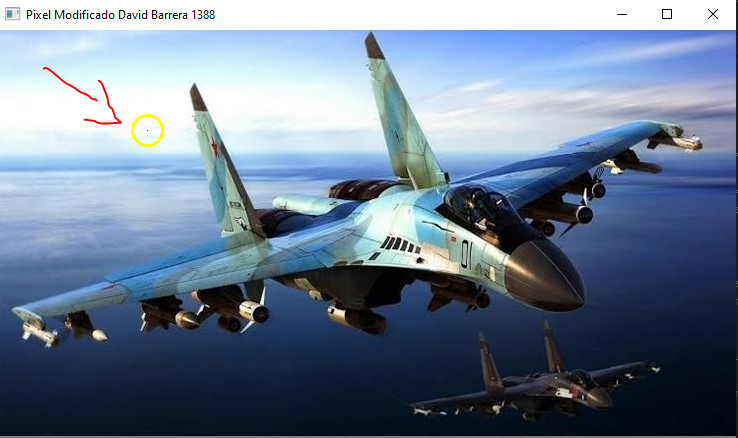
## 5. REGIÓN DE INTERÉS (ROI - REGION OF INTEREST)

## REGIÓN DE INTERÉS (ROI)
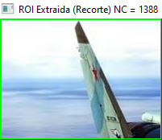
## 6. SEPARACIÓN Y FUSIÓN DE CANALES DE COLOR (BGR)
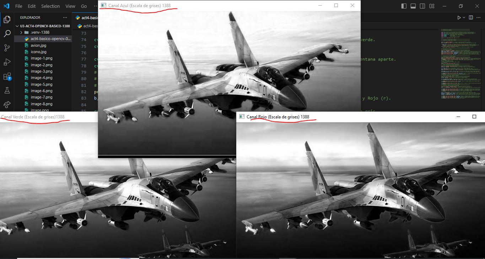
## SEPARANDO Y FUSIONANDO CANALES
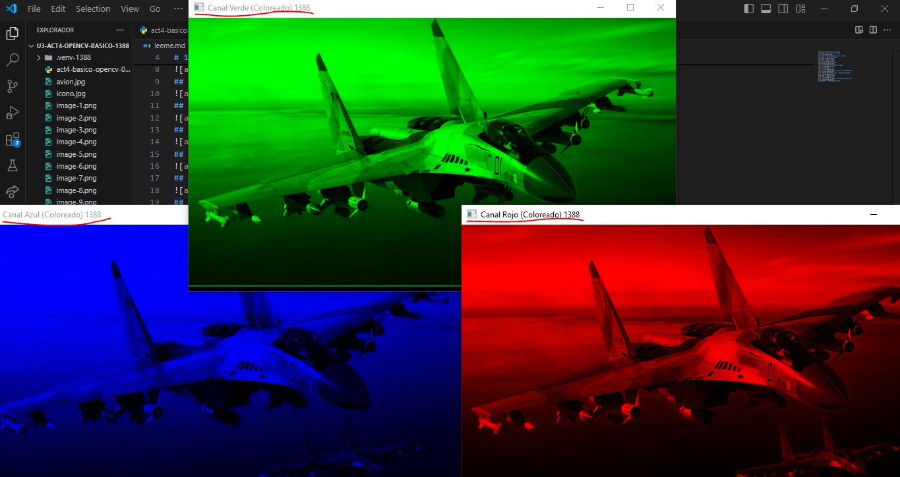
## 7. REDIMENSIONAMIENTO DE IMÁGENES (RESIZING)
## 1. 
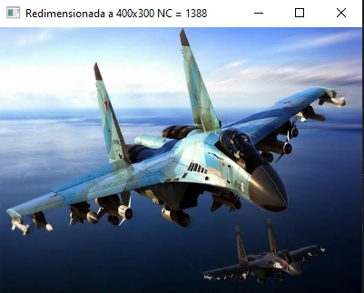
## 2. 
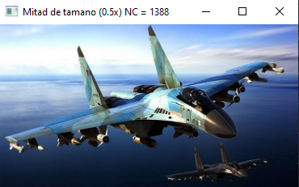
## 3. 
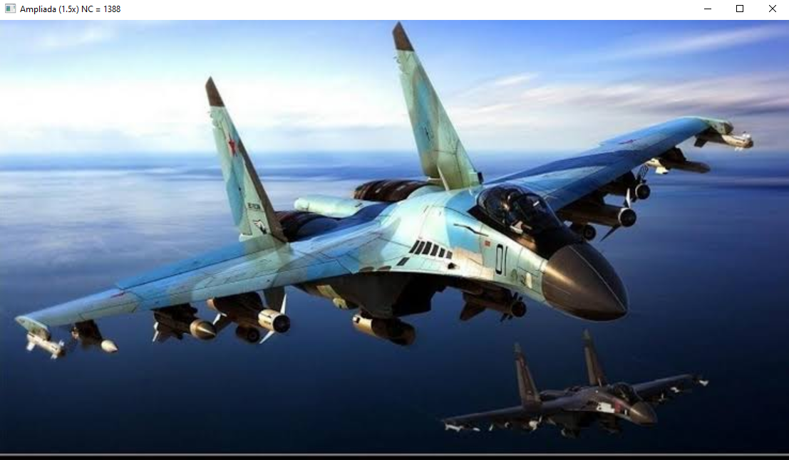
## 8. ROTACIÓN DE IMÁGENES
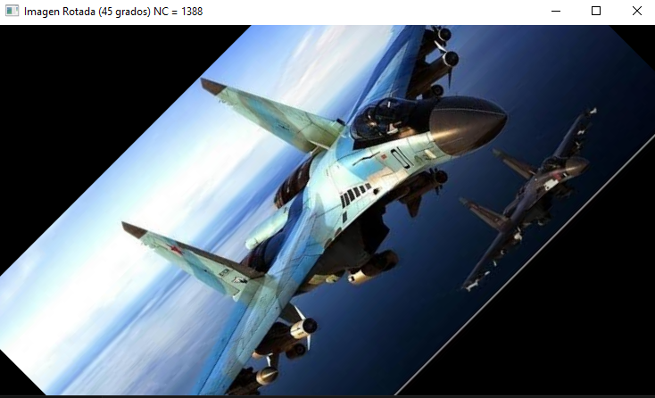
## 9. VOLTEO / ESPEJO DE IMÁGENES (FLIPPING)
## 1.
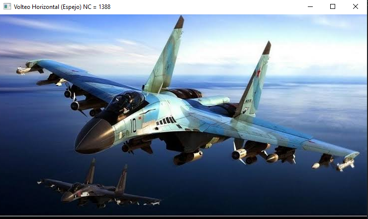
## 2. 
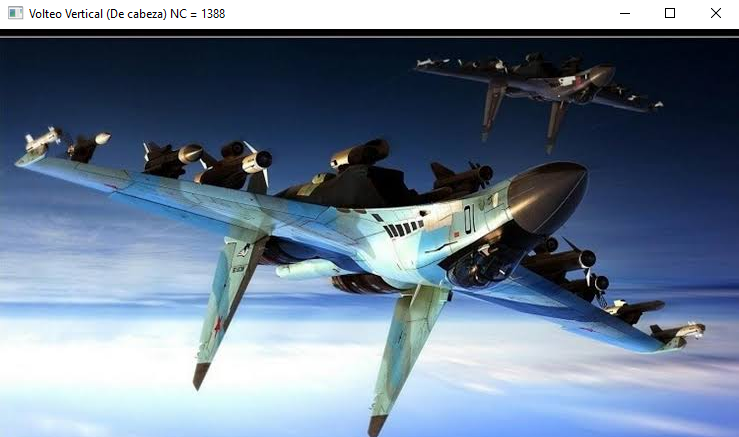
## 3. 
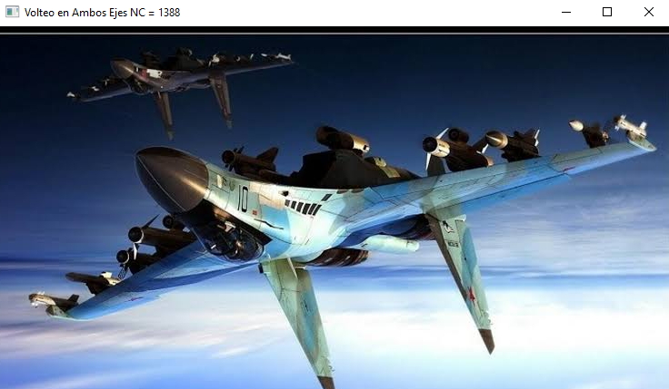
## 10. GUARDADO DE RESULTADOS Y LIMPIEZA
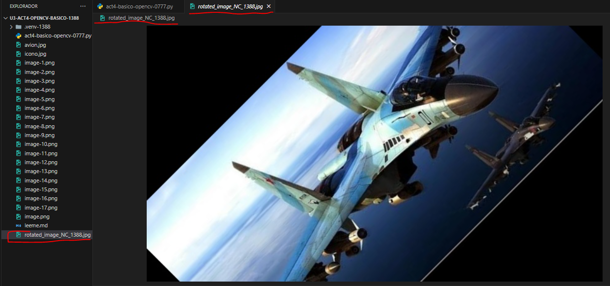
## Confirmacion
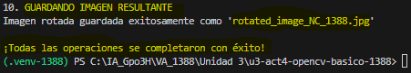